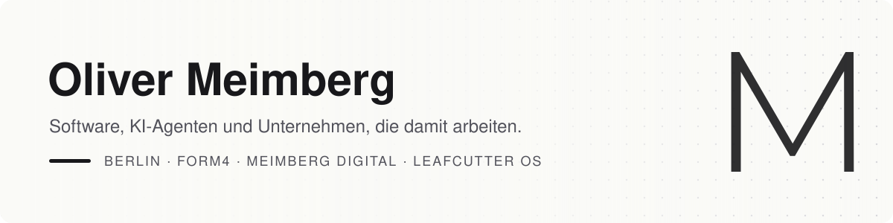

<picture>
  <source media="(prefers-color-scheme: dark)" srcset="assets/banner-dark.svg">
  
</picture>

Mein Schwerpunkt ist die KI-Transformation von Unternehmen: Geschäftsprozesse so neu aufzusetzen, dass KI-Agenten sie ausführen, mit klarer Führung und verbindlichen Regeln.

In meinen eigenen Unternehmen ist das bereits die Arbeitsweise, weit über die Softwareentwicklung hinaus. Als Berater übertrage ich diesen Ansatz auf andere Unternehmen, auch auf große Organisationen. Mit [Leafcutter OS](https://leafcutteros.ai) entwickeln wir die Governance dafür. Grundlage sind mehr als 25 Jahre Erfahrung in Softwareentwicklung und Unternehmensführung.

## 🏢 Unternehmen & Netzwerke

| Wo | Worum es geht |
|---|---|
| **[form4 GmbH](https://www.form4.de)** | Geschäftsführender Gesellschafter. Softwareentwicklung, Websites und Content-Management aus Berlin, seit 25 Jahren: Strategie, Planung, Implementierung und Betrieb. |
| **[meimberg digital](https://meimberg.digital)** | Softwareentwicklung mit KI-Geschwindigkeit. Individuelle Entwicklung, Re-Engineering und Beratung. Gespräch am Montag, Prototyp am Mittwoch. |
| **[Leafcutter OS](https://leafcutteros.ai)** | Mitgründer. Das ausführbare Organisationshandbuch. Rollen, Skills, Adapter und Playbooks als versionierte, geprüfte Pakete, damit eine Organisation sich selbst beschreiben kann, für Menschen und für Agenten. |
| **[AI Business Alliance](https://aibusinessalliance.de)** | Mitgründer. Kuratiertes Netzwerk Berliner Software- und Digitalunternehmen, die KI in ihre Arbeit und ihr Angebot holen. |
| **[Agentic Organisations Collective](https://agentic-organisations-collective.eu)** | Vorstandsmitglied. Gemeinnütziger Verein für Praktiker. Peer-Review für Software-Factory-Architekturen und Organisationsdesign, zwischen KI-Hype und Unternehmensrealität. |

## 🧠 KI-Produkte

| Produkt | Was es tut |
|---|---|
| ✍️ **[SmartEditor](https://smarteditor.app)** | Von der Sprachnotiz zum fertigen Beitrag. Schreibt mit KI-Unterstützung und veröffentlicht auf mehreren Kanälen: Blog, LinkedIn, E-Mail. |
| 🐺 **[Volve](https://www.meimberg.io/projects/volve)** | Führt Ideen über definierte Prozessstufen bis zur Umsetzung, mit KI in jedem Schritt. |
| 📡 **[Pulse](https://pulse.meimberg.io)** | Mein Personal Operating System. Signale, Ideen, Projekte und Aktionen über alle Firmen und Lebensbereiche hinweg an einem Ort. |
| 🦞 **[Morpheuxx](https://www.meimberg.io/projects/morpheuxx)** | Persönlicher AI-Agent, inzwischen auf Hermes. Hat eigene Kanäle und schreibt eigene Texte auf [morpheuxx.meimberg.io](https://morpheuxx.meimberg.io). |

## 📖 Schreiben

- **Netzkultur – Eine Retrospektive** · Buch, in Arbeit. Eine Kulturgeschichte des Netzes, von Mailboxen und Modems bis TikTok, Brainrot und KI.
- **[Blog auf meimberg.io](https://www.meimberg.io/p/blog)** · Artikel über Softwareentwicklung mit Agenten, etwa zu den [Steuerungsmechanismen von Claude Code](https://www.meimberg.io/a/die-steuerungsmechanismen-von-claude-code-claude-md-rules-skills-subagents-und-hooks) oder zum [Intrinsic Software Value](https://www.meimberg.io/a/intrinsic-software-value-ein-messmodell-f-r-die-abrechnung-von-softwareentwicklung-article) als Abrechnungsmodell.
- **[Olis Digital Circus](https://youtube.com/@OlisDigitalCircus)** · YouTube-Kanal mit Experimenten rund um aktuelle KI-Tools.

## 🧪 Nebenprojekte

| Projekt | Worum es geht |
|---|---|
| 🌡️ **[Nahwärmenetz Deisterpfad](https://nahwaermenetz.meimberg.io)** | Infoseite für die Nachbarschaft zum geplanten kalten Nahwärmenetz in unserer Siedlung in Berlin. |
| ✨ **[Luxarise](https://luxarise.com)** | AI-Kunst auf Acryl als Geschäftsidee. |
| 🤖 **[AwesomeApps](https://awesomeapps.meimberg.io)** | Datenbank für Internetdienste, von KI befüllt. |
| 🍳 **[Meimberg's Recipes](https://recipes.meimberg.io)** | Mein Online-Kochbuch, Frontend für eine Notion-Datenbank. |
| 🎨 **[Colory](https://www.meimberg.io/projects/colory)** | Generator für harmonische Farbpaletten. |
| 👾 **[MonsterMemory](https://monstermemory.meimberg.io)** | Memory-Spiel als Web-App. |

**Stack, mit dem ich meistens arbeite:** Next.js · Supabase · Sanity · Storyblok · Claude Code · Docker & Traefik · GitHub Actions

---

      
